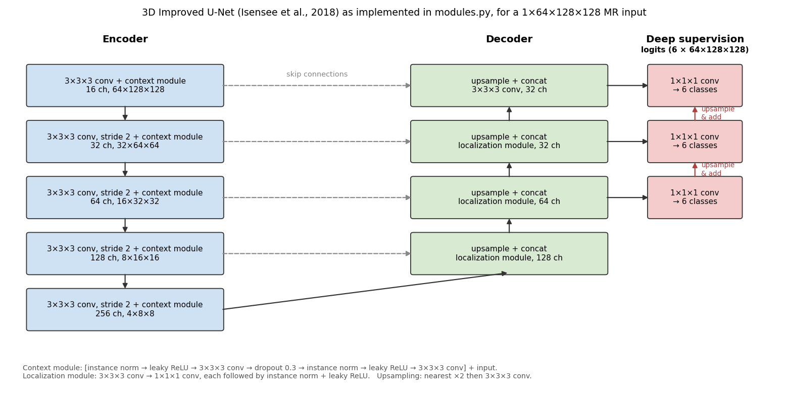
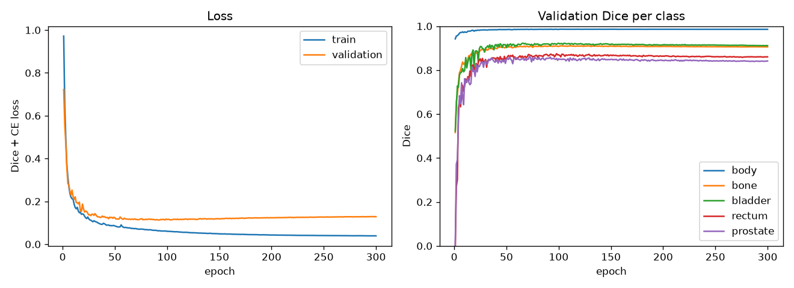
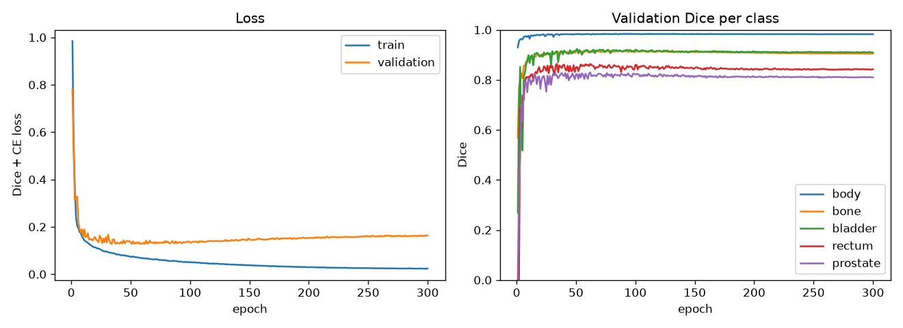
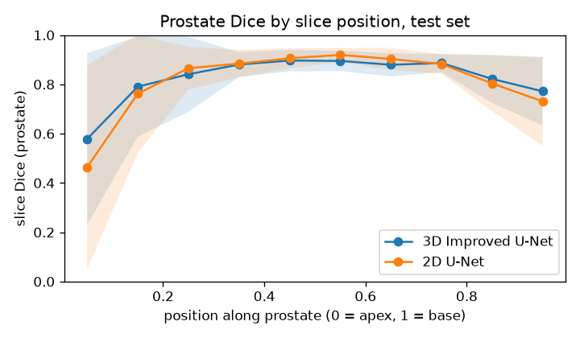
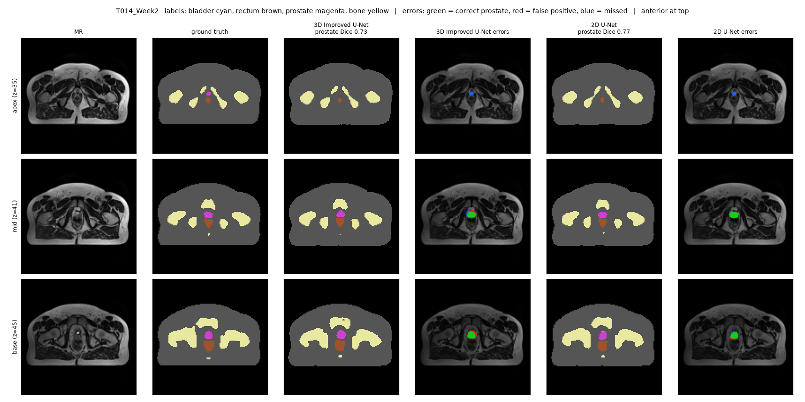
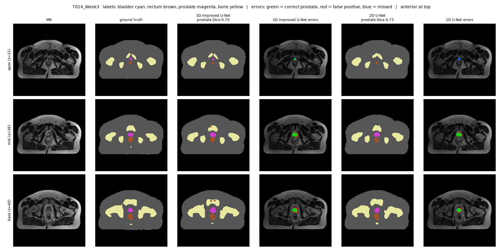
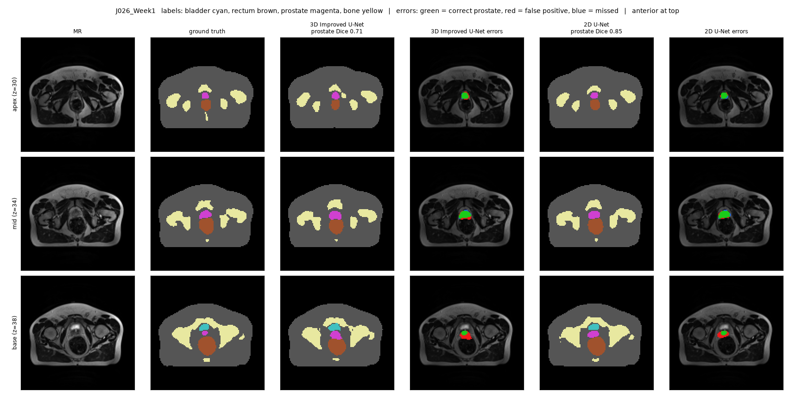
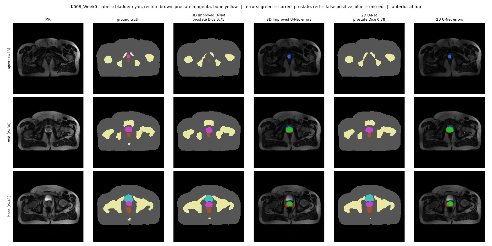
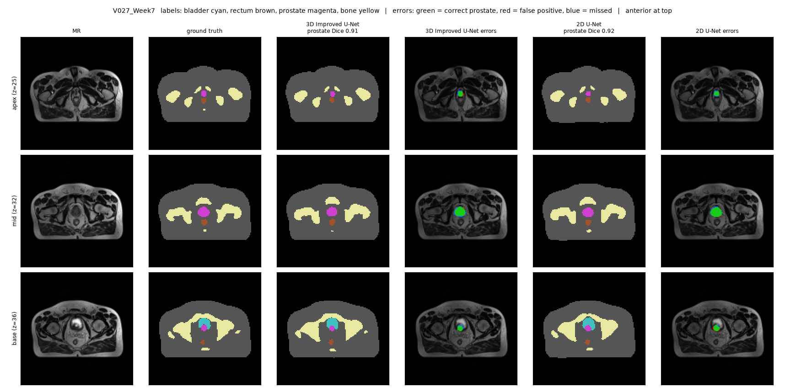

# 3D Improved U-Net for Prostate Segmentation on HipMRI

COMP3710 Pattern Recognition report, segmentation project (task sheet Section 2.2), **Hard**
difficulty. The model is compared against a 2D U-Net baseline to test whether volumetric context
fixes the boundary errors that matter in radiotherapy planning.

## Problem and algorithm

**The problem.** External-beam radiotherapy for prostate cancer is planned on MR or CT scans on
which a specialist outlines the prostate (the target) and the organs at risk next to it, chiefly
the bladder and rectum. Under-contouring the prostate risks the cancer recurring; over-contouring
irradiates the rectal and bladder walls and causes radiation proctitis or cystitis. Manual
contouring is slow, so an automatic draft that a specialist edits could save time. This project
segments 3D pelvic MR volumes from the HipMRI study into six classes (background, body, bone,
bladder, rectum, prostate). The prostate is under 2% of each volume, has low contrast against
its neighbours, and is hardest at its two ends: the apex (inferior) and the base (superior, next to
the bladder). A model can score well on whole-volume Dice while failing at exactly those slices.

**How the 3D Improved U-Net works.** The network (Isensee et al., 2018) is a U-Net built from 3D
convolutions, so every prediction sees neighbouring slices as well as neighbouring pixels. The
encoder halves the spatial size four times with stride-2 convolutions while doubling the channels
(16 to 256). Each level has a *context module*, a residual block of two 3×3×3 convolutions with
dropout, which learns what tissue is present. The decoder upsamples back to full resolution. At each
level it concatenates the matching encoder features through a skip connection, which restores the
fine detail lost in downsampling, and merges them with a *localization module*. Instance
normalisation and leaky ReLU replace batch normalisation, because 3D volumes force batch sizes of
1–2. *Deep supervision* adds 1×1×1 segmentation layers on the three highest-resolution decoder levels
and sums their upsampled outputs, so coarse levels are also trained towards the final segmentation.
Training minimises soft Dice (averaged over the six classes, so the small prostate counts as much as
the background) plus cross-entropy.



The baseline is a standard 2D U-Net (Ronneberger et al., 2015) of similar size: two 3×3
convolutions with batch norm per level, max-pool downsampling, transposed-convolution upsampling and
skip connections. It segments each axial slice independently, and its slice predictions are
stacked back into a volume for scoring.

## Feasibility review

*Presented at the feasibility check-off. Numbers are from the data audit and the first GPU run.*

### 1. User need, scope and acceptance criteria

**User.** A radiation oncology team planning external-beam prostate radiotherapy. Contouring the
prostate and the organs at risk (bladder, rectum) on every planning MR is slow manual work.
**Prototype purpose.** Produce a draft 3D contour of the prostate, bladder, rectum, bone and body
outline that a specialist reviews and edits, not a contour used without review.
**Scope.** Downsampled HipMRI 3D volumes, 6 labels, held-out test patients only. The open question
is whether 3D context fixes the errors that matter clinically (prostate apex and base slices,
leakage into rectum and bladder), or only improves the easy central slices at a much higher cost.

| # | Acceptance criterion (on held-out test patients) | How it is measured |
|---|---|---|
| A1 | 3D model prostate Dice ≥ 0.70 | `train.py` test Dice |
| A2 | 3D model beats the 2D baseline on the apex and base thirds of the prostate, not only the middle third | `predict.py` slice Dice by position |
| A3 | Under 1% of true rectum and bladder voxels labelled prostate, and one prostate component in most cases | `predict.py` leakage and component counts |
| A4 | Training fits in one 3-hour job on one A100; inference under 5 s per volume; peak VRAM reported for both models | `train.py` profiling |
| A5 | No patient appears in more than one split | assertion in `split_by_patient` |

### 2. Model choice and course concepts

- **Model:** 3D Improved U-Net (Isensee et al., 2018), **Hard** difficulty. Encoder-decoder with
  skip connections, residual context modules, strided-convolution downsampling, instance
  normalisation (suits batch sizes of 1–2) and deep supervision across three decoder levels.
- **Baseline:** 2D U-Net (Ronneberger et al., 2015) with a similar parameter count (7.8M vs 8.3M),
  trained on axial slices of the same volumes with the same split, augmentation, loss and
  optimiser. Its slice predictions are stacked into volumes and scored exactly like the 3D model,
  so the comparison isolates 2D vs 3D context.
- **Loss:** soft Dice averaged over classes plus cross-entropy, because the prostate is under 2% of
  voxels and plain cross-entropy would be dominated by background.

### 3. Preliminary feasibility evidence

- **Data audit (Rangpur).** 211 MR volumes with matching labels, named `<patient>_Week<n>_LFOV`, so
  patients have several weekly scans and must be split by patient. Volumes are 256×256×128 at about
  1.56–1.68 mm in-plane and 1.56 mm between slices (close to isotropic, which suits 3D
  convolutions). Labels take the values 0–5. Split by patient with a fixed seed: 136 / 48 / 27
  scans (train / val / test) from 26 / 6 / 6 patients.
- **Pipeline smoke test.** Both models train end to end on synthetic phantoms on CPU; loss falls and
  validation Dice rises within a few epochs, and the evaluation and figure scripts run.
- **Resource estimate.** A 2-epoch run of the 3D model on real data at the 64×128×128 working
  resolution: about 10 s per epoch, 2.1 GB peak VRAM in training and 1.0 GB in inference on an
  A100-PCIE-40GB, with test prostate Dice already at 0.30 after two epochs.

### 4. Risks, budget and fallback

| Risk | Mitigation / fallback |
|---|---|
| GPU access. On the first day jobs sat pending: the partition rejects jobs under the personal account and any `--mem` request | Fixed in `train.slurm` (`--account=comp3710`, no `--mem`). Fallback: train both models on the `cpu` partition for fewer epochs |
| Downsampling to about 3 mm voxels blurs exactly the apex and base slices under study | Next experiment: full resolution (128×256×256) if the first run leaves memory and time to spare |
| Only about 6 test patients, so results vary between patients | Report per-case results and spread, not only means |
| Deep model does not reach Dice 0.70 | Fall back to a plain 3D U-Net (Normal difficulty) with the same pipeline |

**Budget.** Two 3-hour A100 jobs (3D model and baseline) plus one optional full-resolution run.

## Dependencies and reproducibility

Results were produced in this environment on the Rangpur cluster (`requirements.txt` pins the
same versions):

| Package | Version |
|---|---|
| Python | 3.11.15 |
| PyTorch (CUDA) | 2.13.0+cu130 (CUDA 13.0) |
| NumPy | 2.4.6 |
| nibabel | 5.4.2 |
| matplotlib | 3.11.2 |

Hardware: one NVIDIA A100-PCIE-40GB per training job (Slurm partition `comp3710`).

**Reproducibility.**
- The patient split is deterministic: patients are shuffled with seed 42 (`--seed`), and
  `predict.py` rebuilds the same test split from the seed stored in the checkpoint. It refuses to
  compare two checkpoints trained on different splits.
- `train.py` seeds Python and PyTorch. GPU convolutions and bfloat16 autocast are not bit-exact
  between runs, so retraining gives close but not identical numbers. Running `predict.py` twice on
  the same checkpoints gave identical results.
- Each Slurm log records the git commit it ran (`git log --oneline -1`). The runs reported here
  used commit `0f1c3e1`.
- The test Dice computed by `train.py` (GPU, bfloat16) and by `predict.py` (CPU, float32) agree to
  three decimal places (prostate 0.8351 vs 0.8349), a check that both scripts score the same way.

## Data, pre-processing and splits

**Data.** HipMRI Study (`/home/groups/comp3710/HipMRI_Study_open` on Rangpur): 211
pelvic MR volumes in `semantic_MRs/` (`<patient>_Week<n>_LFOV.nii.gz`) with matching label volumes in
`semantic_labels_only/` (`<patient>_Week<n>_SEMANTIC.nii.gz`). Volumes are 256×256×128 voxels with
spacing of about 1.56–1.68 mm in-plane and 1.56 mm between slices. Labels: 0 background, 1 body,
2 bone, 3 bladder, 4 rectum, 5 prostate. The bladder and rectum numbering was confirmed visually
from their positions relative to the prostate in the case figures.

**Pre-processing** (`dataset.py`):
1. Load each Nifti volume with nibabel and reorder axes from (x, y, z) to (depth, height, width).
2. Z-score normalise each MR volume (subtract its mean, divide by its standard deviation), because
   MR intensities have no fixed scale between scans.
3. Resample to 64×128×128 (about 3.1 mm voxels): trilinear for images, nearest-neighbour for
   labels so label values are never blended. This is the "downsampled HipMRI 3D data" the task
   sheet specifies, and it keeps a 3D batch of two volumes at about 2 GB of GPU memory. The cost is
   resolution: the prostate apex is only a few voxels across at this size (see the failure autopsy).
4. Labels are one-hot encoded inside the loss (`DiceCELoss`).

**Augmentation** (training split only, the same for both models): random left-right flip, applied
identically to image and label, and a random intensity scale (±10%) and shift (±0.1).

**Splits.** Split by **patient**, not by scan: each patient has up to 8 weekly scans of the same
anatomy, so putting a patient's scans in both training and test sets would leak their anatomy and
inflate test scores. Patients are shuffled with a fixed seed and allocated 70 / 15 / 15%:

| Split | Scans | Patients | Used for |
|---|---|---|---|
| Train | 136 | 26 | fitting weights |
| Validation | 48 | 6 | choosing the best epoch (highest validation prostate Dice) |
| Test | 27 | 6 | all reported results, used once at the end |

`split_by_patient` asserts that no patient appears in two splits. Scan counts are uneven because
patients have different numbers of weekly scans.

## Usage

All commands run from this folder. The real data lives on Rangpur; `--synthetic` runs the same
code on generated phantoms so everything can be checked on a laptop CPU.

```bash
pip install -r requirements.txt

# 1. Check the data pipeline (prints split sizes and class fractions)
python dataset.py --synthetic
python dataset.py --root /home/groups/comp3710/HipMRI_Study_open --preview preview.png

# 2. Check both models build and the loss behaves
python modules.py

# 3. Train (on Rangpur through Slurm; extra arguments are passed to train.py)
sbatch train.slurm unet3d
sbatch train.slurm unet2d
#    or directly:  python train.py --model unet3d --amp --out runs/unet3d
#    CPU smoke test: python train.py --model unet3d --synthetic --epochs 2 --shape 32 64 64

# 4. Test-set analysis and figures from the saved checkpoints
python predict.py --unet3d runs/unet3d_<job>/best.pt --unet2d runs/unet2d_<job>/best.pt
```

**Outputs.** `train.py` writes to `runs/<model>_<job>/`, which is git-ignored so no weights are
committed:
- `best.pt`
- `history.json`
- `curves.png` (loss and per-class validation Dice per epoch)
- `test_metrics.json` (test Dice and IoU, parameters, peak VRAM, timing)
- `test_per_case.csv`

`predict.py` prints the report shown in the results and writes the figures in `figures/`.

**Rangpur notes.**
- Jobs on `comp3710` must use `--account=comp3710`; with the default personal account they stay
  pending with reason `PartitionConfig`.
- Jobs must not request `--mem`: nodes are registered with 1 MB of memory, so any memory request
  never matches a node.

`train.slurm` handles both.

**Example input and output.** Each case figure in the results shows the input MR slice, the
ground-truth labels, and both models' predicted labels with prostate error overlays.

**Training curves** for the reported runs (written by `train.py` every epoch):

| 3D Improved U-Net (job 707428) | 2D U-Net (job 707429) |
|---|---|
|  |  |

Both models converge within about 50 epochs, after which validation Dice is flat. From about
epoch 60–100, validation loss creeps up while training loss keeps falling: mild overfitting,
stronger for the 2D model (validation loss 0.13 → 0.17) than the 3D model (0.12 → 0.13). This is
why the checkpoint with the best validation prostate Dice (epochs 72 and 62) is used instead of the
final epoch. Later epochs add training time but not accuracy.

## Results

All results are on the 27 held-out test scans (6 patients), at the 64×128×128 working
resolution, using the checkpoint with the best validation prostate Dice (3D: epoch 72, 2D:
epoch 62, of 300). Both models use the same split, pre-processing, augmentation, loss and
optimiser. Numbers are mean ± standard deviation over test scans, from `predict.py`.

### 2D U-Net baseline vs 3D Improved U-Net: whole-volume overlap

| Class | 3D Dice | 2D Dice | 3D IoU | 2D IoU |
|---|---|---|---|---|
| Body | 0.987 ± 0.003 | 0.984 ± 0.004 | 0.974 | 0.969 |
| Bone | 0.918 ± 0.012 | 0.925 ± 0.010 | 0.848 | 0.861 |
| Bladder | 0.938 ± 0.058 | 0.951 ± 0.033 | 0.889 | 0.909 |
| Rectum | 0.856 ± 0.046 | 0.862 ± 0.065 | 0.751 | 0.762 |
| **Prostate** | **0.835 ± 0.060** | **0.835 ± 0.056** | 0.721 | 0.721 |

Both models pass the 0.70 prostate Dice target (acceptance criterion A1), and on whole-volume
overlap they are indistinguishable. Validation prostate Dice favoured the 3D model (0.862 vs
0.830), but that gap did not carry over to the test patients.

### Where along the prostate the models fail

Each test scan's prostate is divided into slices from apex (0) to base (1). The base end is
identified as the end nearer the bladder, so the orientation comes from the anatomy, not from
an assumed file orientation. Slice Dice is averaged within each position bin across all test scans.



| Prostate slice Dice | 3D Improved U-Net | 2D U-Net | 3D − 2D |
|---|---|---|---|
| Apex tip (first 10%) | **0.579** | 0.464 | +0.115 |
| Apex third | **0.756** | 0.720 | +0.036 |
| Middle third | 0.890 | **0.910** | −0.020 |
| Base third | **0.816** | 0.792 | +0.024 |
| Base tip (last 10%) | **0.772** | 0.731 | +0.041 |

| Boundary error | 3D Improved U-Net | 2D U-Net |
|---|---|---|
| Scans whose predicted prostate is split into more than one piece | **1 / 27** | 4 / 27 |
| Mean number of prostate pieces per scan | **1.07** | 1.19 |
| Slices with predicted prostate beyond the true apex or base, per scan | 1.96 | **1.44** |
| True rectum voxels labelled prostate | 0.27% | **0.03%** |
| True bladder voxels labelled prostate | **0.39%** | 0.60% |
| True prostate voxels labelled rectum or bladder | 0.53% | 0.52% |

Identical whole-volume Dice hides two opposite effects. The 3D model is better at both ends of
the prostate, most of all at the apex tip, and produces fewer fragmented contours, but is slightly
worse in the easy middle slices. It also carries the prostate a little further past its true ends
and labels more of the rectum as prostate, while the 2D model leaks more into the bladder.

**Caution on significance.** The 27 test scans come from only 6 patients, and scans of the same
patient are not independent. Differences of 0.02–0.04 in the thirds are smaller than the
scan-to-scan spread (about 0.06), so they are indicative only. The apex-tip gap (+0.115) and the
fragmentation counts (1 vs 4 scans) are the clearest signals.

### Resource profiling

Measured by `train.py` on one NVIDIA A100-PCIE-40GB with bfloat16 autocast.

| | 3D Improved U-Net | 2D U-Net | 3D ÷ 2D |
|---|---|---|---|
| Trainable parameters | 8,279,074 | 7,762,630 | 1.07× |
| Peak VRAM, training | 2.08 GB | 0.97 GB | 2.1× |
| Peak VRAM, inference | 1.01 GB | 0.48 GB | 2.1× |
| Inference time per scan (median) | 0.011 s | 0.009 s | 1.2× |
| Training time, 300 epochs | 0.49 h (5.9 s/epoch) | 0.66 h (7.9 s/epoch) | 0.74× |

At this resolution the 3D model costs about twice the memory of the 2D baseline, well short of
the 5–10× the task sheet warns about, and it trains faster because each step processes two whole
volumes instead of 32 slices. Peak VRAM depends on the batch sizes chosen (2 volumes vs 32 slices),
so the memory ratio describes these training settings, not the architectures in isolation.

### Per-patient consistency

Because scans of one patient are correlated, the position comparison was repeated per patient
(mean over that patient's scans) and per scan:

| 3D better than 2D | Apex third | Middle third | Base third |
|---|---|---|---|
| Test patients | **5 / 6** | 1 / 6 | **4 / 6** |
| Test scans | **17 / 27** | 7 / 27 | **17 / 27** |

The pattern from the averages holds patient by patient: 3D context helps at the ends and the
2D baseline is better in the middle. The test set is unbalanced (J026, T014 and V027 contribute
8 scans each; K008, S028 and T009 one each), so the per-patient row is the fairer summary.

### Failure case autopsy

`predict.py` plots the four test scans with the lowest 3D prostate Dice, plus the best scan for
reference. Each figure shows an apex, a mid and a base slice (the worst apex and base slices for
the 3D model, and the largest mid slice). Columns: MR, ground truth, then for each model the
prediction and an error overlay (green correct prostate, red false positive, blue missed).

**1. Apex tip missed by both models: T014_Week2 (3D 0.725, 2D 0.765) and K008_Week0 (0.753, 0.785).**

At the apex slice the prostate is only a few voxels across at the 3 mm working resolution, and both
models miss it entirely (all blue). At this resolution the apex is barely distinguishable from the
surrounding tissue on the MR slice. This is the failure the research question is
about, and 3D context does not fix it: when the apex is this small, neither model sees it.

**2. Apex partly recovered by 3D context: T014_Week3 (3D 0.702, 2D 0.734).**

This scan has the lowest 3D Dice, yet at the apex slice the 3D model finds part of the prostate
while the 2D model misses it completely. The 3D model's lower whole-volume score comes from the
mid and base slices, where its contour has a thin false-positive rim (red ring) one voxel outside
the true boundary, and from 7 slices of prostate predicted beyond the true apex and base (2D: 5).
This rim appears across the 3D failures and explains its lower middle-third Dice: volumetric
context makes the contour smoother and slightly larger.

**3. Leakage towards the rectum: J026_Week1 (3D 0.715, 2D 0.845).**

The scan where 3D does worst relative to 2D. At the mid and base slices the 3D contour spreads
posteriorly, and 3.4% of the true rectum is labelled prostate (2D: 0.2%). This is the clinically
dangerous direction: dose to the rectal wall causes radiation proctitis. 3D rectal leakage is
concentrated in a few scans (J026_Week1 3.4%, J026_Week0 2.2%, K008_Week0 1.1%; every other
scan under 0.6%), so acceptance criterion A3 (under 1% leakage) holds on average but fails for
3 of 27 scans.

**4. Bright bladder at the base: K008_Week0.**

At the base the bladder is very bright and sits directly against the prostate. Both models leave
missed voxels on the anterior (bladder) side, and the 3D model also adds a false-positive edge
posteriorly. K008 is a single-scan patient with the lowest apex Dice of all patients (3D 0.41,
2D 0.34), and the 2D model split its prostate into 3 pieces.

**Reference, best case: V027_Week7 (3D 0.915, 2D 0.915).**

Both models are close to the ground truth on all three slices, with only a small missed edge at
the apex.

**Patterns across the failures.** Three of the four worst scans come from one patient (T014,
mean apex Dice 0.61 for 3D and 0.54 for 2D), so the hardest cases are patient-specific rather than
random. The two models fail differently: the 2D model misses apex slices outright and fragments
the prostate (4 scans vs 1), while the 3D model over-contours with a smooth rim and occasionally
leaks into the rectum.

### Recommendation

**Use the 3D Improved U-Net as the drafting model, but keep mandatory manual review of the apex
slices and the prostate-rectum interface. Neither model is suitable for unreviewed contours.**

- **3D context gives a real but limited gain where it matters.** At equal whole-volume Dice (0.835
  each) it is better at the apex in 5 of 6 test patients and at the base in 4 of 6, with the
  largest gain at the apex tip (+0.115 slice Dice), and produces fragmented prostates in 1 scan
  instead of 4.
- **The cost is small at this resolution.** About 2× peak VRAM (2.1 GB vs 1.0 GB), slightly
  slower inference (0.011 s vs 0.009 s per scan) and shorter training (0.49 h vs 0.66 h). The 5–10×
  overhead the task sheet warns about does not appear at 64×128×128, so cost is not a reason to
  prefer 2D.
- **3D context does not solve the apex.** Apex-tip Dice is still only 0.58, and both models miss
  the apex entirely in several scans (T014, K008). The first apex slices should always be
  contoured or checked by hand.
- **3D introduces its own risk at the rectum.** Its contours run one voxel large, and in 3 of 27
  scans it labels over 1% of the rectum as prostate, which would raise rectal dose if accepted
  unchecked. The posterior border needs review in every case.
- **Unsuitable for automated drafting:** apex slices; base slices where a bright bladder abuts
  the prostate; patients whose anatomy resembles T014.
- **Limits of this evidence.** Six test patients, one random split and one training run per model;
  the differences in the thirds are smaller than the scan-to-scan spread. Before deployment:
  patient-level cross-validation, and a higher working resolution (the 3 mm voxels used here are
  coarsest exactly at the apex). A largest-connected-component step and a small erosion could
  also be tested against the 3D model's oversized rim.

## Artificial Intelligence Usage Disclosure

Claude Code was used throughout this project for code generation, debugging and drafting
documentation. I ran all training and evaluation on Rangpur myself, and checked every claim in
this report against the logged outputs listed below.

| Date | Tool | What it helped with | How I verified it |
|------|------|---------------------|-------------------|
| 2026-10-28 | Claude Code (Claude Opus 5.5) | Repository setup, project folder scaffold, README skeleton, first version of `dataset.py` (synthetic generator, file pairing, patient-level split) | Listed the real file names, scan count (211) and label values (0–5) on Rangpur and checked they matched the loader's naming pattern and class list. Confirmed the split sizes (26 / 6 / 6 patients) on the real data; `split_by_patient` asserts no patient is in two splits. Confirmed the bladder and rectum label numbers visually from their positions in the case figures. |
| 2026-10-28 | Claude Code (Claude Opus 5.5) | `modules.py` (3D Improved U-Net, 2D U-Net, Dice + CE loss), `train.py`, `utils.py`, `train.slurm` | Checked the architecture against Isensee et al. (2018) level by level. Smoke tests: both models give the right output shapes, the loss is 0 for a perfect prediction and large for a wrong one, and both train on synthetic data. Ran a 2-epoch job on the real data on Rangpur before the full runs (loss fell, prostate Dice rose to 0.30). Training curves show both full runs converging. |
| 2026-10-28 | Claude Code (Claude Opus 5.5) | Diagnosing pending Slurm jobs (account and `--mem` problems) from `scontrol` / `sinfo` output | Ran `sinfo`, `scontrol show job` and a `diff` of my pending job against a running job on Rangpur. The differences (memory request and account) matched the diagnosis, and after each fix the job's pending reason changed and it ran. |
| 2026-10-28 | Claude Code (Claude Opus 5.5) | `predict.py` (apex-to-base slice Dice, leakage, connected components, case figures), checkpoint-selection bug fix | Ran `predict.py` twice on Rangpur on the same checkpoints and got identical results. Its test Dice agrees with `train.py`'s (prostate 0.8349 vs 0.8351). The checkpoint bug was found on a synthetic run where the best epoch stayed at 1; after the fix the best epoch advanced. Inspected every case figure against the reported numbers. |
| 2026-10-29 | Claude Code (Claude Opus 5.5) | Interpreting results, per-patient comparison, architecture diagram, drafting README sections (feasibility review, results, failure autopsy, recommendation, usage) | Checked the README's numbers against `test_metrics.json` and `predict_results.json`, and the architecture diagram against `modules.py`. Reviewed the failure-case descriptions against the figures, and the recommendation against the results, including the limits of a 6-patient test set. |

## References

1. F. Isensee et al., "Brain tumor segmentation and radiomics survival prediction: Contribution
   to the BRATS 2017 challenge," *Brainlesion*, 2018.
2. O. Ronneberger, P. Fischer and T. Brox, "U-Net: Convolutional networks for biomedical image
   segmentation," *MICCAI*, 2015.
3. Ö. Çiçek et al., "3D U-Net: Learning dense volumetric segmentation from sparse annotation,"
   *MICCAI*, 2016.
